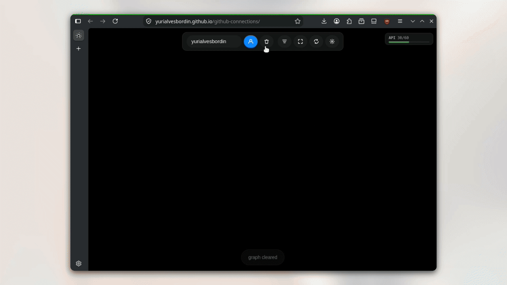

# GitHub Connections

Interactive force-directed graph visualization of GitHub user connections. Explore followers, following, and repository relationships in real time.



## Overview

GitHub Connections is a browser-based application that visualizes the social graph of GitHub users. Enter a username to load their node, then expand to reveal their followers, following, and top repositories. The graph uses a physics-based layout engine running in a Web Worker to maintain responsive interaction even with thousands of nodes.

## Features

### User Exploration
Search any GitHub username to add their node to the graph. Nodes display the user's avatar, login, and connection statistics. Long-press or right-click a node to fetch its followers and following connections.

### Interactive Graph
The graph uses a force-directed layout where nodes repel each other and edges act as springs. Drag nodes to reposition them. Scroll to zoom, drag the background to pan. Double-click a user node to display their top repositories. Right-click for a context menu with options to view details, expand connections, focus and center, open on GitHub, or remove the node.

### Connection Types
Three relationship types are represented visually:
- Mutual connections (green): both users follow each other
- One-way connections (orange): only one user follows the other
- Repository links (purple): a user's top repositories connected to their node

### Filtering
Two filtering modes are available:
- Connection filter (toolbar button): cycles between All, Mutual Only, and One-Way Only
- Person filter (username input): when typing a username that already exists in the graph, all unrelated nodes and edges are dimmed, highlighting only that person's direct network

### Persistence
Graph state is saved to localStorage automatically and restored on page load. A GitHub personal access token can be configured to increase the API rate limit from 60 to 5,000 requests per hour.

## Controls

| Action | Method |
|--------|--------|
| Load user | Press Enter in search input or click Load button |
| Clear graph | Click Clear button |
| Fit to view | Click Fit button |
| Regenerate layout | Click Shuffle button |
| Filter connections | Click Filter button to cycle modes |
| Person filter | Type username in search input |
| Delete node | Press Delete key or use context menu |
| Expand connections | Long-press node or use context menu |
| Show repositories | Double-click user node |
| Open on GitHub | Quick-click node or use context menu |

## Getting Started

No build step required — just install the one dependency and serve the directory:

```bash
npm install
python3 -m http.server 8080
# or
npx serve .
```

Then open http://localhost:8080 in a modern browser.

## Architecture

```
├── index.html           # Application entry point (includes the import map)
├── css/
│   ├── main.css         # Core styles and layout
│   └── ui.css           # Component-specific styles
├── js/
│   ├── main.js          # Application orchestration and Graphium integration
│   ├── config.js        # Constants
│   ├── graph.js         # Graph data structure and operations
│   ├── api.js           # GitHub REST API client
│   ├── storage.js       # localStorage persistence
│   └── ui/
│       ├── topbar.js        # Search input and toolbar buttons
│       ├── filterPanel.js   # Connection type filter control
│       ├── infoPanel.js     # Node detail modal
│       ├── contextMenu.js   # Right-click context menu
│       ├── tokenModal.js    # GitHub token configuration
│       ├── toast.js         # Toast notifications
│       ├── rateLimitBar.js  # API rate limit indicator
│       └── onboarding.js    # First-time user guided tour
├── serve.py             # Dev server with cache disabled (recommended)
└── assets/
    ├── Showcase.gif         # Demonstration animation
    └── images/              # Favicons and static assets
```

### Built with Graphium
The entire graph layer — physics, rendering and interaction — is powered by
[`@yurialvesbordin/graphium`](https://www.npmjs.com/package/@yurialvesbordin/graphium),
a high-performance WebGL2 graph visualization library. The app imports it as a
plain ES module resolved through an [import map](https://developer.mozilla.org/en-US/docs/Web/HTML/Element/script/type/importmap)
declared in `index.html`, so no bundler or build step is needed.

### Physics Engine
Graphium's physics engine uses a spatial hash for O(n) neighbor queries, spring forces for edges with per-link rest lengths, collision prevention, and a sleep state that pauses the render loop entirely when kinetic energy drops below a threshold.

### Rendering
Graphium renders nodes and curved edges on the GPU through WebGL2, targeting 60 frames per second. Node avatars are uploaded to a GPU texture atlas. The camera supports smooth panning and zooming with wheel, pinch and drag gestures, and pointer interactions (drag, hover, click, double-click, long-press, context menu) are handled by Graphium's built-in pointer controller and event system.

## GitHub Token Configuration

Click the key icon in the toolbar to open the token modal. To create a token:

1. Navigate to https://github.com/settings/tokens
2. Generate a new token (classic)
3. No scopes are required for public data access
4. Copy the token and paste it into the modal

The token is stored only in browser memory for the current session and is never transmitted except directly to the GitHub API.

## Onboarding

First-time users are guided through a four-step tutorial:
1. Load a user
2. Expand connections
3. Explore the graph
4. Filter connections

The onboarding can be dismissed or completed at any time.

## Rate Limits

| Authentication | Limit |
|----------------|-------|
| Unauthenticated | 60 requests per hour |
| Personal access token | 5,000 requests per hour |

The toolbar displays the remaining quota with a color-coded indicator.

## Browser Support

Modern browsers with ES modules, import maps and WebGL2 support:
- Chrome 89+
- Firefox 108+
- Safari 16.4+
- Edge 89+

## License

MIT License: see LICENSE file for details.

---

GitHub Connections: a portfolio project demonstrating vanilla JavaScript architecture, Web Workers, Canvas rendering, and force-directed graph layouts.